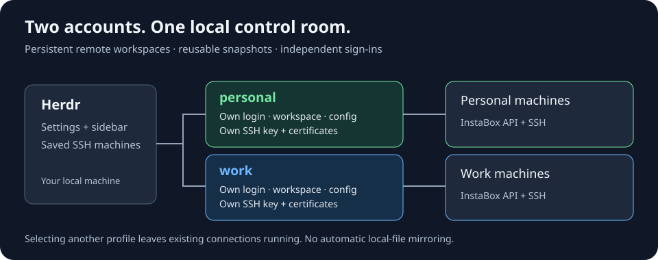

# InstaBox for Herdr

**Create cloud machines, open persistent workspaces, and reuse your best environments—without leaving Herdr.**

[](https://github.com/mdp/herdr-instabox/actions/workflows/ci.yml)
[](https://herdr.dev)


Create a machine, reconnect to a persistent workspace, or turn a prepared environment into a snapshot—without leaving [Herdr](https://herdr.dev). Sign in to [InstaBox](https://instabox.sh) with GitHub or Google. No InstaBox CLI required.



[Quick start](#quick-start) · [Everyday controls](#everyday-controls) · [Examples](examples/README.md) · [Configuration](docs/configuration.md) · [Troubleshooting](docs/troubleshooting.md)

## Why use it?

- **Native remotes.** Running machines appear as saved SSH machines in Herdr’s sidebar.
- **Persistent workspaces.** Work directly on your cloud machine, reconnect when you need it, and choose a default for new workspaces.
- **Reusable environments.** Copy a machine or save a snapshot, then create another machine from it.
- **Credentials chosen for the job.** Select InstaBox Secrets per account and override them per snapshot—including an empty selection.
- **Operations survive the pane.** Create, start, suspend, stop, copy, and delete run in the background, with notifications when finished.
- **Automatic SSH certificates.** The plugin manages its own key and renews short-lived certificates before connections.
- **Multiple accounts when you need them.** Keep separate logins and configuration connected side by side.

> **Mental model:** this is a persistent **remote-machine manager**, not a local-file mirroring tool. Your code lives on the machine where you open the workspace. The plugin does not upload your local checkout, copy host agent credentials, or automatically bring edits back.

## Quick start

### 1. Install

You need **Herdr 0.9.0+**, **Go 1.27.1+** to build, OpenSSH (`ssh` and `ssh-keygen`), and Linux or macOS. You also need an InstaBox account with access to the intended workspace.

```bash
herdr plugin install mdp/herdr-instabox
```

This is a fork of [v01dstar/herdr-instabox](https://github.com/v01dstar/herdr-instabox). The plugin ID remains **`v01dstar.instabox`** to preserve existing installations. Do not install both copies side by side; back up your config/state before replacing an existing installation.

For a local checkout:

```bash
git clone https://github.com/mdp/herdr-instabox.git
cd herdr-instabox
go build -o bin/herdr-instabox .
herdr plugin link "$PWD"
bin/herdr-instabox install-keys
```

Linking does not run build steps. Installation adds missing default keybindings; existing bindings are left alone.

### 2. Sign in

With **Local** selected in Herdr’s sidebar, press **`prefix+m`** to open InstaBox settings. Open **account** and choose **Sign in with GitHub** or **Sign in with Google**.

On first setup, you can create a private starter config with no selected Secrets and Vault delivery disabled. Existing config is never replaced. GitHub uses a device code when a browser is unavailable; Google needs a local browser.

### 3. Create a machine and work

1. In **remotes**, choose **+ Add remote**, name the machine, and create it from the default template or a snapshot.
2. Wait for it to run and appear in Herdr’s sidebar.
3. Select the machine in the sidebar and open a workspace. Clone your repository on the remote machine if needed.
4. To use the shortcut, return to **Local**, open settings, choose **Use as default** for that machine, then press **`prefix+shift+m`**.

The shortcut creates a workspace on the selected profile’s default; it **does not start a stopped machine**. After creating a remote workspace, select it in the sidebar—plugins cannot switch the client for you.

`prefix` is your configured Herdr prefix. Plugin keybindings currently work only while **Local** is selected.

## Everyday controls

| Where | What you can do |
| --- | --- |
| **remotes** | Start/resume, suspend, stop, test, rename locally, choose default, hide/show, copy, delete, add SSH remotes |
| **snapshots** | Create a machine from a snapshot; delete a snapshot |
| **account** | Sign in, add/select profiles, sign out of one profile, inspect usage |
| `prefix+m` | Open settings from Local |
| `prefix+shift+m` | New workspace on the selected profile’s default |

The plugin reconciles all accounts at Herdr startup and at most once a minute on workspace events. The open settings pane refreshes its profile every 15 seconds. Running machines are enabled; stopped/suspended machines already registered remain disabled in the sidebar. A machine never seen running cannot be registered until it runs.

## Learn by example

| Recipe | You’ll learn |
| --- | --- |
| [Minimal](examples/minimal/README.md) | A safe starter configuration |
| [Reusable dev machine](examples/dev-machine/README.md) | Prepare once, snapshot, create a second machine, clean up |
| [Custom workspaces](examples/workspaces/README.md) | Templates, snapshot selection, and repository paths |
| [Snapshot credentials](examples/snapshot-credentials/README.md) | Select or explicitly omit Secrets for each image |
| [Multiple accounts](examples/multiple-accounts/README.md) | Independent logins, configuration, and scoped logout |

### Using more than one account?

In **account**, choose **Add another account…**, then use **`[` / `]`** to select a profile and sign in. Other profiles stay connected. Each has independent configuration; personal Secrets and defaults are not inherited. See the [complete recipe](examples/multiple-accounts/README.md) and [authentication guide](docs/authentication.md).

## Diagnostics and trust

```bash
bin/herdr-instabox --help
bin/herdr-instabox doctor
bin/herdr-instabox doctor --json
```

`doctor` only reads local files and checks executable availability. It does not contact the API, refresh tokens, repair SSH, or create machines. `whoami` verifies the effective identity online. Diagnostic output contains local paths; review before sharing.

Secrets intentionally delivered to a cloud machine are accessible there. Closing settings leaves machines running, and signing out removes local connections rather than stopping cloud machines—**billing may continue**. See [security](SECURITY.md) and [lifecycle details](docs/design.md).

## Documentation

- [Usage and machine lifecycle](docs/usage.md)
- [Authentication and account isolation](docs/authentication.md)
- [Configuration reference](docs/configuration.md)
- [Troubleshooting and recovery](docs/troubleshooting.md)
- [Architecture and design](docs/design.md)
- [Verification and live smoke-test checklist](docs/verification.md)
- [Contributing](CONTRIBUTING.md) · [Changelog](CHANGELOG.md) · [Documentation index for agents](llms.txt)

## Development

```bash
go test ./...
go test -race ./...
go vet ./...
go build -o bin/herdr-instabox .
python3 scripts/check-docs.py
```

Tests use a fake InstaBox API and Herdr CLI—no cloud account needed. CI checks Linux/macOS, example configs, local documentation links, and builds. Live cloud behavior is a separate [verification step](docs/verification.md), not implied by a green unit-test badge.

### Acknowledgments

Built on [v01dstar’s original plugin](https://github.com/v01dstar/herdr-instabox). Documentation and onboarding patterns were informed by the [Docker Sandboxes](https://github.com/dirien/herdr-sbx-plugin), [Blaxel](https://github.com/blaxel-ai/herdr-blaxel-sandbox-plugin), [Upstash Box](https://github.com/upstash/herdr-upstash-box), and [Vercel Sandbox](https://github.com/vercel-labs/herdr-vercel-sandbox-plugin) plugins. This integration is not an official Herdr product.
