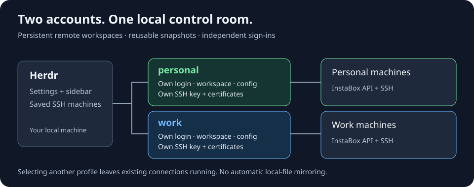

# Architecture and design

[Home](../README.md) · [Security](../SECURITY.md)

## A remote manager, not an upload bridge

The plugin talks directly to the InstaBox API and drives Herdr’s CLI for saved machines, workspaces, and notifications. It requires no InstaBox CLI login. Herdr itself is unmodified. Work happens on the remote filesystem; there is no local checkout upload or patch-back protocol.

## Process-per-account

`prepareAccount` selects state/config roots before asynchronous work begins. The UI restarts when switching profiles. Other-account sync and background jobs use subprocesses, so credentials are never swapped under pending requests. Shared Herdr registry and SSH config writes use root-level locks; profile-local refresh/state operations use profile-local locks.

`personal` retains the original paths and SSH aliases. Named profiles live below `accounts/<name>` and use namespaced Herdr SSH targets. Cleanup is limited to the owning namespace. Profile names are validated and account discovery ignores symlink directories.

## Verified identity, scoped operations

A first verified sign-in records user/default-workspace binding in `identity.json`. Optional config overrides are checked against actual authentication and membership. Lists are filtered to effective workspace, while mutations/exec/certificate issuance validate target scope as well. Jobs record the identity that admitted them and refuse execution if it changes.

Authenticated requests use the issuer saved with the credentials. Ambient CLI account/server overrides cannot silently redirect a profile’s existing auth. This guards accidental account mixing; server permissions remain the authorization boundary.

## SSH and reconciliation

Each account owns its SSH key, known hosts, Host files, and short-lived certificates. The personal alias is `herdr-instabox-<machine id>`; named aliases include their account namespace. A per-profile Include references those files from `~/.ssh/config`.

API-issued certificates last 24 hours. SSH `Match exec` renews them before a connection when fewer than 10 minutes remain, carrying the owning state/config/account context. A failed scope check cannot reuse an old certificate. An already open connection can outlive its certificate.

Sync registers running machines, disables existing nonrunning entries, and removes hidden/deleted managed targets. It runs at startup, on throttled workspace events, and periodically in settings. Herdr validates remotes on add, so a never-running machine is not registered in advance.

## Configuration and recovery

Config must decode strictly before normal CLI execution. Resource listing, machine creation, and workspace defaults re-read it to catch edits during a running UI session. Secret selections are not allowed to silently fall back after JSON errors. Explicit `env` values override the env file. Snapshot profiles replace Secret selection and merge metadata.

Detached job runners record results so closing the pane does not cancel work. The cloud API can succeed before the local runner records success; recovery therefore requires inspecting remote state before retrying resource creation. No automatic retry loop creates extra machines after an unknown outcome.

## Repository map

| Files | Responsibility |
| --- | --- |
| `main.go`, `diagnostics.go`, `setup.go` | CLI routing, help, read-only diagnostics, guided setup |
| `accounts.go`, `identity.go`, `auth.go` | Profile selection, identity policy, browser/device auth |
| `config.go` | Strict configuration and fleet/snapshot matching |
| `api.go`, `instabox.go` | API calls and resource models |
| `sync.go`, `herdr.go`, `state.go` | Herdr reconciliation and durable state/locks |
| `sshconf.go`, `sshkey.go` | SSH integration and certificate lifecycle |
| `jobs.go`, `ui*.go` | Background operations and terminal UI |
| `testdata/fake/`, `fakeapi_test.go` | Offline integration fixtures |
